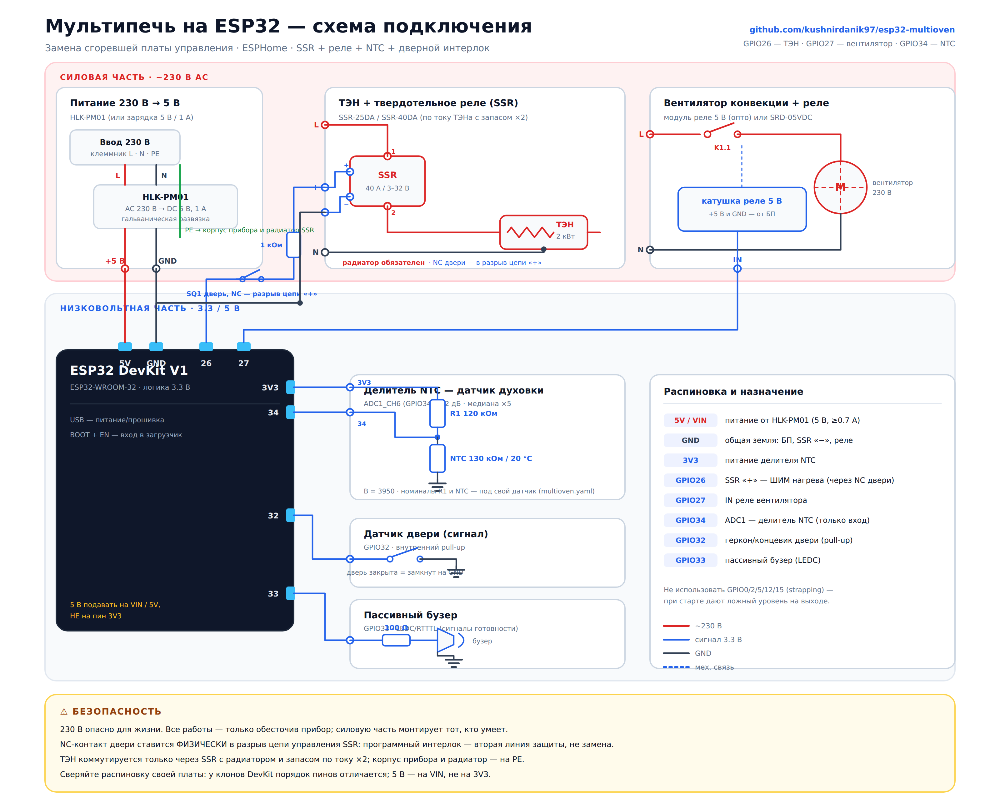

# Мультипечь на ESP32

**Замена сгоревшей платы управления мини-печи (мультипечи) на ESP32 + ESPHome.**
Тот же ТЭН, тот же вентилятор, тот же датчик — но управление по Wi-Fi, PID-стабилизация
температуры, программы готовки и дверной интерлок, который физически снимает нагрев.

<p>


</p>



> Схема в векторе: [`docs/wiring.svg`](docs/wiring.svg) · генератор: [`tools/wiring.py`](tools/wiring.py)

---

## Зачем это

У мультипечи (мини-печи, «пицца-печки») сдыхает плата управления: пробивает симистор,
умирает контроллер, залипает кнопка. Новая плата по модели часто не продаётся вообще, а
универсальная китайская — это та же лотерея плюс месяц ожидания.

Внутри прибора — три копеечных узла: **ТЭН**, **вентилятор конвекции** и **термопара/NTC**.
Их достаточно, чтобы собрать управление заново на ESP32 и получить прибор даже лучше
заводского:

- температура держится PID-регулятором, а не «щелчком биметалла» — просадка под нагрузкой
  компенсируется;
- программа готовки (температура + время) запускается с телефона или из Home Assistant;
- дверь открыл — нагрев снят, и **физически** тоже (NC-контакт в цепи управления SSR);
- Wi-Fi упал/сервер выключен — печь **продолжает готовить**: вся логика живёт на ESP32,
  сеть нужна только для команд и телеметрии.

Стоимость железа — порядка **1000–1500 ₴**, всё покупается в любом радиомагазине.

---

## Что умеет

| Функция | Как реализовано |
|---|---|
| Нагрев ТЭНа | SSR, время-пропорциональное управление (slow PWM, период 8 с) |
| Стабилизация температуры | `climate: pid` — kp 0.3 / ki 0.002, цель 50–250 °C |
| Вентилятор конвекции | реле 5 В, включается вместе с программой |
| Датчик температуры | NTC-делитель на ADC1 (GPIO34), медианный фильтр ×5 |
| Защита от перегрева | жёсткий предел 280 °C: нагрев off + аварийный сигнал |
| Дверь | геркон/концевик на GPIO32 + NC-контакт в цепи управления SSR |
| Программы | Ручной · Пицца 230 °C/15 мин · Выпечка 180 °C/40 мин · Разогрев 100 °C/20 мин |
| Таймер | обратный отсчёт, текстовая сущность «Осталось времени» |
| Звук | пассивный бузер: старт/готово/авария (RTTTL) |
| Сеть | ESPHome API (шифрованный) + OTA + captive portal, если Wi-Fi не тот |

Сознательные ограничения — в разделе [Чего здесь нет](#чего-здесь-нет-и-почему).

---

## Железо

### Что купить

| # | Компонент | Зачем | Ориентир, ₴ |
|---|---|---|---|
| 1 | ESP32 DevKit V1 (ESP32-WROOM-32, 30 пинов) | мозг | 350–450 |
| 2 | Твердотельное реле **SSR-25DA** (или 40DA) | коммутация ТЭНа без щелчков и износа | 200–350 |
| 3 | Радиатор под SSR | без него SSR умрёт: ~1.6 В падения × 9 А ≈ 15 Вт тепла | 80–150 |
| 4 | **HLK-PM01** (230 В → 5 В, 1 А) или любая зарядка 5 В/1 А | питание платы | 150–250 |
| 5 | Модуль реле 5 В, 1 канал, с оптопарой | вентилятор 230 В | 50–80 |
| 6 | Резисторы: 120 кОм 1 %, 1 кОм, 100 Ом | делитель NTC, затвор SSR, бузер | 10 |
| 7 | Конденсатор 100 нФ (опция) | фильтр помех на ADC | 5 |
| 8 | Пассивный бузер 5 В | звуковая индикация | 25 |
| 9 | Клеммники, провода 1.5 мм², термоусадка | монтаж | 100 |

> Цены — ориентир по украинским магазинам на 2026 год, не истина в последней инстанции.

### Родные детали печи, которые переиспользуются

- **ТЭН** (обычно 1.2–2 кВт — для SSR на 25 А это с запасом ×2.5);
- **вентилятор** 230 В;
- **датчик температуры**. Обычно это NTC 100 кОм при 25 °C, но бывает и 50/130 кОм.
  Обязательно измерьте свой (см. [docs/tuning.md](docs/tuning.md#1-паспорт-датчика-ntc)) —
  номиналы в конфиге подставлены под 130 кОм @ 20 °C и почти наверняка потребуют правки;
- **дверной концевик** — если он живой, он же становится NC-контактом безопасности.

### Пины ESP32

| Пин | Назначение | Примечание |
|---|---|---|
| GPIO26 | выход на SSR «+» | через NC-контакт двери и 1 кОм |
| GPIO27 | IN модуля реле (вентилятор) | `restore_mode: ALWAYS_OFF` |
| GPIO34 | ADC1_CH6 — делитель NTC | только вход, подтяжек нет |
| GPIO32 | геркон/концевик двери | внутренний pull-up, замыкание на GND = закрыто |
| GPIO33 | пассивный бузер | LEDC |
| 5V/VIN | питание от HLK-PM01 | **не** подавать 5 В на 3V3 |
| GND | общая земля | обязательно общая с SSR «−» и реле |

Пины 0/2/5/12/15 не используются намеренно: это strapping-пины, при старте они дают
ложный уровень, а нам нельзя дёргать ТЭН при загрузке/прошивке.

### Силовая часть

```
L ──[QF1 16 A]──┬──────────────[SSR 1]──[SSR 2]──[ТЭН]──┐
                │                                       │
                │──[K1.1]──[вентилятор]──┐              │
                │                        │              │
                └──[HLK-PM01 AC-L]      │              │
N ──────────────────────────────────────┴──────────────┘
PE ──── корпус прибора + радиатор SSR
```

**Радиатор для SSR обязателен.** При 8–9 А через SSR падает ~1.6 В — это ~15 Вт на
корпусе; без радиатора он выйдет из строя за десятки часов.

---

## Сборка: по шагам

### 1. Прошивка

Нужен [ESPHome](https://esphome.io) 2026.8 или новее. Три равнозначных способа:

```bash
# CLI
pip install esphome
cd esp32-multioven
cp secrets.example.yaml secrets.yaml   # заполнить своими значениями
esphome run multioven.yaml             # первая прошивка — по USB
```

- **Home Assistant**: Settings → Add-ons → ESPHome → открыть панель → New device →
  вставить содержимое `multioven.yaml`.
- **Без установки**: [web.esphome.io](https://web.esphome.io) (Chrome/Edge, WebSerial).

Проверка конфига без сборки:

```bash
esphome config multioven.yaml     # "Configuration is valid!"
esphome compile multioven.yaml    # "Successfully compiled program."
```

> Проект проверен на ESPHome **2026.8.1**: `config` — valid, `compile` — успешно.

### 2. `secrets.yaml`

```yaml
wifi_ssid: "ИМЯ_СЕТИ"          # только 2.4 ГГц, ESP32 не умеет 5 ГГц
wifi_password: "..."
api_key: "..."                 # openssl rand -base64 32
ota_password: "..."
```

`secrets.yaml` в git не попадает — он в `.gitignore`.

### 3. Стенд без 230 В (не пропускать)

Сначала соберите низковольтную половину и проверьте её, ничего не включая в сеть:

1. NTC (или резистор-эквивалент на его место) → делитель → GPIO34. В логе
   `Температура духовки` должна быть комнатная температура ±2 °C. Погрели датчик в
   руке — значение выросло.
2. Вместо ТЭНа — светодиод с резистором 1 кОм на выход SSR «+»/«−»: команда «Старт»
   должна давать мигание с периодом 8 с (скважность зависит от PID).
3. Замкнули/разомкнули дверь — в логе `SAFETY: дверь открыта`, нагрев снят.
4. GPIO27 → вход модуля реле: щёлкает при старте программы, отпускает по «Стоп».

Только после этого — силовая часть.

### 4. Монтаж в прибор

1. Обесточить, вынуть вилку. Разрядить конденсаторы БП (подождать минуту).
2. Демонтировать мёртвую плату, **оставить** силовые провода ТЭНа, вентилятора, датчик.
3. HLK-PM01 — на L/N после автомата; выход 5 В → VIN ESP32.
4. SSR — на радиатор, силовые клеммы в разрыв провода ТЭНа, управление → ESP32.
5. Модуль реле — в разрыв провода вентилятора, вход IN → GPIO27.
6. Корпус прибора и радиатор — на **PE**. Металлический корпус без земли не оставлять.
7. ESP32 — вне зоны нагрева: температура внутри кожуха легко 60–70 °C, это предел для
   модуля. Ставьте у холодной стенки, при необходимости — с экраном из фольги.

### 5. Настройка в Home Assistant / приложении ESPHome

Устройство появится как `multioven` со сущностями:

- `climate.duhovka_pid` — целевая температура, режим HEAT/OFF;
- `switch.ventilyator_konvekcii`;
- `number.ruchnoy_rezhim_temperatura` / `..._vremya`;
- `select.programma_gotovki`;
- `button.start` / `button.stop`;
- `sensor.temperatura_duhovki`, `text_sensor.status_pechi`, `text_sensor.ostalos_vremeni`;
- `binary_sensor.dver_duhovki`, `binary_sensor.pereGrev_avariynyy_predel`.

Логика простая: выбираете программу → «Старт». Ручной режим берёт температуру и время из
`number`-сущностей, программа — свои значения. По истечении таймера нагрев и вентилятор
выключаются, играет сигнал.

### 6. Калибровка и тюнинг

NTC почти всегда врёт на 5–15 °C, а PID-коэффициенты из коробки дают перерегулирование.
Как померить, посчитать B-константу, подобрать R1 и настроить PID — в
**[docs/tuning.md](docs/tuning.md)**.

---

## Безопасность

Это прибор с открытым нагревателем на 230 В и металлическим корпусом. Коротко:

- **Дверной NC-контакт ставится физически** в разрыв цепи управления SSR. Программный
  интерлок (`binary_sensor.on_press`) — вторая линия защиты, а не замена: если прошивка
  зависнет или GPIO залипнет, контакт двери всё равно снимет управление.
- **SSR залипает.** Твердотельные реле выходят из строя «включёнными». Поэтому:
  - в приборе остаётся родной термопредохранитель/биметаллический термостат, если он был —
    не выкусывайте его;
  - жёсткий предел 280 °C в прошивке — третья линия, а не первая.
- **Радиатор SSR обязателен**, корпус SSR не должен касаться горючего.
- **PE на корпус и радиатор.** Прибор с металлическим корпусом без заземления —
  это не «мелочь».
- Первое включение — под наблюдением, с автоматом 16 А. Не оставляйте собранный прибор
  без присмотра, пока не убедились в стабильности 2–3 циклов.

> Автор не несёт ответственности за пожар, удар током и испорченный ужин. Если вы не
> работали с 230 В — отдайте силовую часть электрику.

---

## Чего здесь нет и почему

Честный список, чтобы не было сюрпризов:

- **Нет панели управления на самом приборе.** Родная плата умерла вместе с дисплеем и
  кнопками; управление — по Wi-Fi. Если нужен автономный прибор с энкодером, добавьте
  OLED + EC11 (в ESPHome это `display` + `sensor: rotary_encoder`) — конфиг к этому готов,
  просто пока не сделан.
- **Нет фазового регулирования мощности.** Только время-пропорциональное (ШИМ по периоду
  8 с). Для ТЭНа этого достаточно: инерционность печи — минуты. Плюс — нет помех в сеть.
- **Нет второго датчика.** Один NTC в объёме; при желании второй (например, на противне)
  добавляется на свободный ADC-пин.
- **Не сертифицировано.** Это самоделка, а не заводское изделие.

## Возможные доработки

- OLED SSD1306 + энкодер — управление без телефона;
- второй NTC и `sensor`-фильтр для равномерности;
- MQTT-мост в Home Assistant (если не нужен нативный API);
- лог температур в InfluxDB/Grafana для подбора PID.

---

## Структура репозитория

```
multioven.yaml          # прошивка ESPHome: пины, климат, программы, защита
secrets.example.yaml    # шаблон секретов
docs/wiring.svg|png     # схема подключения
docs/tuning.md          # калибровка NTC и настройка PID
tools/wiring.py         # генератор схемы (SVG → PNG через браузер)
```

## Лицензия

MIT — берите, переделывайте, ставьте в свой прибор.

## English summary

ESP32 + ESPHome drop-in replacement for a dead control board in a mini-oven / multi-oven.
PID-controlled heating element via SSR (time-proportional PWM), convection fan relay, NTC
divider on ADC1, hard over-temperature cut-off, door interlock (hardware NC contact in the
SSR control loop + software), cooking presets with a countdown timer, buzzer, encrypted
ESPHome API and OTA. ~$30 of parts; validated with ESPHome 2026.8.1 (`config` valid,
`compile` OK). See `docs/wiring.png` for the wiring and `docs/tuning.md` for NTC
calibration and PID tuning. MIT licensed.
